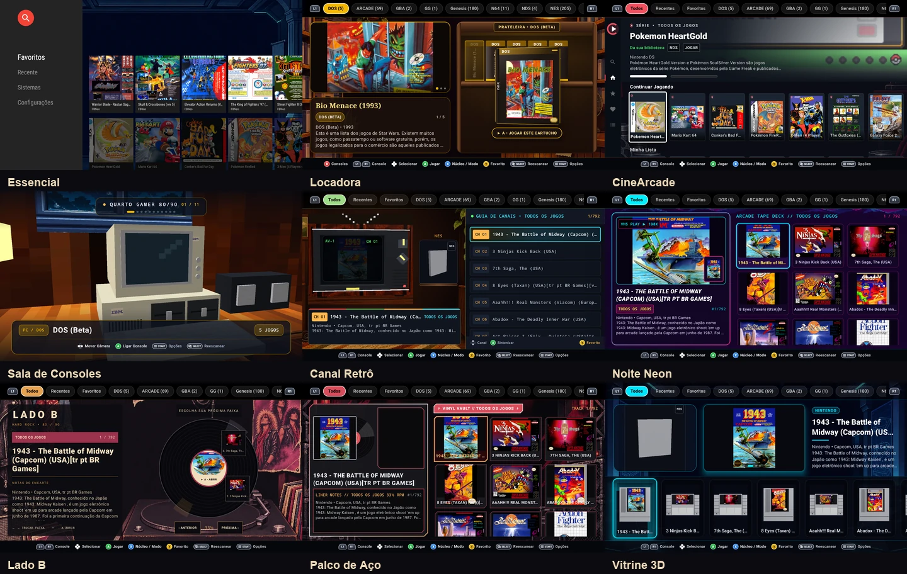

# Artes geradas em todos os temas e texturas 3D



Pesquisa online, prompts e registro de origem: [REFERENCES.md](../art-source/theme-art-20261121/REFERENCES.md), [prompts dos temas](../art-source/theme-art-20261121/theme-prompts.json), [prompts das texturas](../art-source/theme-art-20261121/prompts.json) e [registro de assets](../art-source/theme-art-20261121/asset-register.csv).

Foram gerados oito fundos originais e duas texturas pela ferramenta nativa `image_gen`. O Lado B conserva sua arte gerada na etapa anterior. O modelo/versionamento não é exposto pela ferramenta; não há uma afirmação de uso de uma versão específica de DALL-E. A geração ocorre somente durante a produção, sem acesso de IA/rede pelo aplicativo para desenhar o tema.

| Tema visível | Chave preservada | Arte/estilo |
|---|---|---|
| Essencial | `default` | Arquivo minimalista azul, detalhes ciano discretos |
| Locadora | `locadora` | Loja de bairro, VHS, balcão, madeira e âmbar |
| CineArcade | `netflix` | Cinema escuro, vinho, veludo e projeção |
| Sala de Consoles | `console` | Quarto nostálgico, madeira, tecidos e janela noturna |
| Canal Retrô | `tv` | Sala analógica, madeira, tecido e iluminação quente |
| Noite Neon | `retro_80_90` | Horizonte pixel art, montanhas, magenta/ciano e grade |
| Lado B | `rockstar` | Camarim hard rock original; arte anterior preservada |
| Palco de Aço | `thrash_metal` | Treliças, metal marcado, amplificadores e luz vermelha |
| Vitrine 3D | `three_d` | Exposição de hardware, formas angulares e luz fria |

O catálogo associa a arte à chave existente. Layouts de TV com fundos opacos recebem a imagem no próprio contêiner; a navegação padrão Leanback e a página inicial padrão móvel recebem a arte Essencial. Telefone em retrato mantém as adaptações compartilhadas. Os textos, capas, badges e controles continuam nativos e legíveis.

## Texturas e custo

- Oito novos WebP 1280 × 853 somam 641.814 bytes. Originais PNG ficam fora do APK. Imagens são estáticas, sem animação/redecodificação por quadro.
- Atlas de ambiente continua 512², 4 × 2 células, nearest/RGB565, com madeira, piso, tecido, CRT, pôster, janela e letreiro em pixel art.
- Atlas do hardware continua 1024 × 512. Somente a célula neutra ABS de 128² mudou; as demais células, incluindo as artes Arcade aprovadas, foram comparadas e são pixel a pixel iguais.
- O plástico usa UV por face, com grão neutro muito sutil. O tint do material conserva a cor original de cada console e cartucho.
- Foram comparados os 48 modelos antes/depois ignorando somente UV: posições, normais, cabeçalhos de material e quantidade de partes permaneceram idênticos. Continuam 10.868 triângulos, máximo de 570 por malha e oito partes.
- Mídias mantêm capa dinâmica na última parte e miniaturas RGBA 256² derivadas do mesmo modelo; 24 miniaturas foram regeneradas.
- Não houve alteração no relógio GL, no giro contínuo das mídias, no lifecycle, nos modos de emulação, no automático, nos overrides ou nas molduras.

## Reprodução e conferências

```powershell
python tools/art/prepare_theme_art.py
& 'C:\Program Files\Blender Foundation\Blender 5.2\blender.exe' -b --python tools/art/pack_hardware_atlas.py
& 'C:\Program Files\Blender Foundation\Blender 5.2\blender.exe' -b --python tools/art/build_faithful_hardware.py
& 'C:\Program Files\Blender Foundation\Blender 5.2\blender.exe' -b --python tools/art/render_hardware_previews.py
python tools/art/validate_l3d.py
```

Blender 5.2.2 LTS executado; atlas, fontes `.blend`, pranchas e miniaturas atualizados. Validador independente passou para 48 meshes e 24 miniaturas, incluindo SHA256, UV, normais, limites e capa frontal. Compilação Kotlin e `assembleFreeDynamicDebug -PlemuroidAbis=armeabi-v7a` passaram offline. O APK foi inspecionado: nove artes temáticas e bibliotecas somente ARMv7.

APK: `build/releases/Lemuroid-Custom-20261121-generated-art-armv7.apk`; 79.984.164 bytes; SHA256 `211d8454a6df6425eca8d354c93129a300d41de5389793a7f0c7c4e3dbd2e351`.

Evidências locais da TV e logs: `build/theme-art-validation/`. Não inferir FPS entregue de screenshots, nem validação em telefone ou em todos os 24 sistemas de hardware a partir de pranchas offline.

Os nove temas foram abertos e capturados na TCL ARMv7. Nas seleções 3D de Locadora e Sala de Consoles, A entrou somente no catálogo DOS; nenhuma partida foi iniciada. Os fundos foram conferidos também atrás dos catálogos. Um vazamento de `ContentScale.Crop` sobre a barra superior foi detectado nas capturas e corrigido com `clipToBounds`; as capturas finais foram repetidas na compilação corrigida. O tema Essencial mantém o fluxo Leanback, com arte de fundo própria.

Qualidade e molduras Desativado (bordas pretas) foram verificadas nas configurações durante as trocas de tema. O telefone foi compilado, mas não houve inspeção visual em um aparelho de telefone nesta sessão. Não há comparação controlada de fluidez ou promessa de 60 FPS.

Movimento da mídia selecionada na Vitrine 3D foi confirmado por duas capturas separadas, no mesmo recorte: 15.598 pixels alterados em Desempenho, 19.988 em Equilibrado e 13.358 em Qualidade; também passou imediatamente após a entrada (20.670). Esses números provam mudança visual, não FPS entregue. A configuração final foi restaurada para Lado B, Todos, item 1/792, Qualidade e molduras desativadas. O SHA256 do APK instalado foi comparado ao artefato local.
