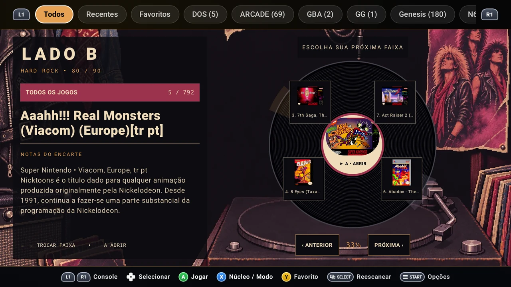

# Lado B — tema de hard rock 80/90

O tema substitui a apresentação anterior de Distrito Arcade/Rockstar. A chave persistida `rockstar`, a posição no enum e a ordem da preferência continuam iguais: usuários que já o selecionaram recebem a nova apresentação sem migração destrutiva.

## Direção visual e interação

- Camarim em pixel art: couro, jeans, bandana, rebites, equipamentos de palco, papel gasto e pôster de personagens fictícios com cabelos volumosos. Âmbar, creme, vinho e magenta suave sobre carvão.
- Nenhum nome, logotipo, fotografia, capa de disco ou música de banda foi incluído. Origem, pesquisa e prompt exato em [PROVENANCE.md](../art-source/hard-rock-vinyl/PROVENANCE.md).
- Na TV e em paisagem, descrição/encarte à esquerda (40%) e vinil à direita (60%). No celular em retrato, vinil acima do encarte, com tipografia compacta.
- O selo central mostra a capa selecionada; até quatro capas vizinhas aparecem sobre o disco. Setas trocam uma faixa por vez, inclusive para cima/baixo. Botões de anterior/próxima e capas também aceitam toque. Bibliotecas grandes não criam uma composição para cada jogo.
- A confirma pelo fluxo existente. Grupos continuam abrindo a escolha de versões/CDs. X continua permitido somente em um jogo concreto; dentro de um grupo, é preciso escolher uma versão/CD.
- Retorno por ID, filtro, favoritos, recentes, confirmação de saída e preferências por jogo/sistema continuam no frontend compartilhado.

## Custo e perfis

A arte original 1536 × 1024 foi convertida para WebP de 219.604 bytes, mantendo o original fora do APK. O disco usa primitivas Canvas e uma camada que gira. O estado da rotação é lido somente na camada gráfica; capas e encarte não recompõem por quadro. Nenhuma nova dependência foi adicionada.

O giro é contínuo nos três perfis, com intervalos de atualização de 16/33/50 ms em Qualidade/Equilibrado/Desempenho. Esses intervalos são limites solicitados pela animação, não medições de FPS entregue. Em segundo plano a coroutine é cancelada pelo estado de lifecycle já compartilhado. O relógio GL dos modelos 3D não foi alterado.

Não há alterações nos critérios automáticos de perfil, overrides de núcleo/modo, shaders, saves ou molduras.

## Compilação e validação

APK ARMv7: `build/releases/Lemuroid-Custom-20261121-hard-rock-vinyl-armv7.apk`.

- SHA256: `90a37f05ef3f7ebf750a5240dd9c0ee691830b06edc207f01a936bc21a06e7d9`.
- 79.982.140 bytes; ZIP inspecionado, bibliotecas somente `armeabi-v7a`.
- `:lemuroid-app:assembleFreeDynamicDebug -PlemuroidAbis=armeabi-v7a`: passou, offline.
- Ktlint 1.2.1 nos dois arquivos novos/reformulados de layout: passou. Não representa uma checagem de estilo completa de todo o repositório.
- `git diff --check`: passou.
- TV TCL ARMv7 em `192.168.15.78:5555`: instalação por atualização, sem jogo aberto. Conferência visual em 1920 × 1080, navegação linear e X abrindo opções/voltando ao mesmo item confirmados. Nenhum jogo foi iniciado durante este teste do tema.
- Celular: componente responsivo compilado; sem validação visual em aparelho de telefone nesta sessão.

Os registros locais da execução ficam em `build/hard-rock-validation/`. As amostras de gfxinfo incluem animação ociosa, capturas e 16 passos de navegação por perfil; não são uma comparação controlada com o tema antigo nem uma garantia de ausência de engasgos.

| Perfil | Quadros da amostra | Jank reportado | p95 | Pixels alterados no recorte do vinil |
|---|---:|---:|---:|---:|
| Desempenho | 492 | 7,93% | 30 ms | 27.700 |
| Equilibrado | 787 | 8,39% | 24 ms | 81.199 |
| Qualidade | 1.023 | 1,66% | 21 ms | 20.989 |

As capturas confirmam movimento nos três modos, não a taxa de rotação apresentada. As amostras foram obtidas na compilação `a3dd52ae…`, antes da última correção de navegação; diferenças de cache/cena/duração impedem concluir que um perfil é mais rápido que outro.

Na sequência rápida apareceu uma leitura atrasada da posição: eventos podiam chegar antes de uma nova composição e usar o índice anterior. O comando linear agora consulta `selectedGameIndex` no momento do evento. A compilação final passou na TV: 16 passos à direita levaram de 1 a 17; 16 à esquerda retornaram a 1; cima passou a 792 e baixo retornou a 1. Não houve partidas iniciadas. X abriu opções do jogo e voltou ao item, e B na raiz mostrou a confirmação de saída.

Ao concluir, Lado B ficou selecionado para revisão; perfil Qualidade e molduras Desativado (bordas pretas) foram preservados. Os padrões e overrides dos núcleos não foram alterados.
